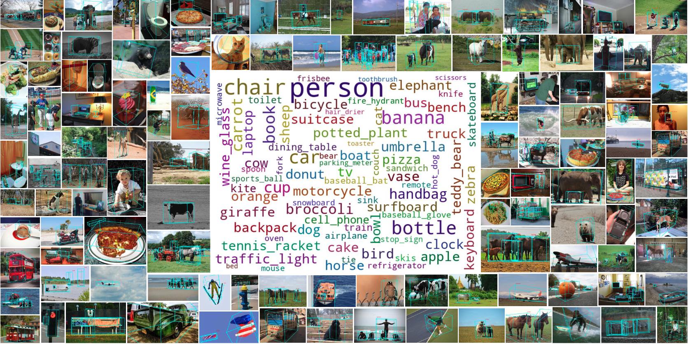

<div align="center">

# LabelAny3D: Label Any Object 3D in the Wild

[Jin Yao][jy], [Radowan Mahmud Redoy][rr], [Sebastian Elbaum][se], [Matthew B. Dwyer][md], [Zezhou Cheng][zc]


[](https://uva-computer-vision-lab.github.io/LabelAny3D/)
[](https://openreview.net/pdf?id=Q2fU0JDHuW)


</div>

<table style="border-collapse: collapse; border: none;">
<tr>
    <td width="100%">
        <p align="center">
            Samples from COCO3D dataset
            
        </p>
    </td>
</tr>
</table>

## COCO3D Dataset

The evaluation set of COCO3D and pseudo-labeled training set are available at [Hugging Face](https://huggingface.co/datasets/uva-cv-lab/COCO3D).

## 3D BBox Human Refinement Interface

We release the source code for the refinement interface at https://github.com/UVA-Computer-Vision-Lab/3d_annotator.

## Getting Started

📦 **[Installation Guide](docs/INSTALL.md)** - Setup instructions and external dependencies

📖 **[COCO Pipeline Guide](docs/COCO_PIPELINE.md)** - Run the pipeline on COCO dataset

🔧 **[OVMono3D Fine-tuning](https://github.com/UVA-Computer-Vision-Lab/LabelAny3D/tree/ovmono3d_finetune)** - Code for fine-tuning OVMono3D on LabelAny3D pseudo annotations

## Citing

If you find this work useful for your research, please kindly cite:

```BibTeX
@inproceedings{yao2025labelany3d,
  title={LabelAny3D: Label Any Object 3D in the Wild},
  author={Jin Yao and Radowan Mahmud Redoy and Sebastian Elbaum and Matthew B. Dwyer and Zezhou Cheng},
  booktitle={Neural Information Processing Systems (NeurIPS)},
  year={2025}
}

@inproceedings{yao2025open,
  title={Open Vocabulary Monocular 3D Object Detection},
  author={Yao, Jin and Gu, Hao and Chen, Xuweiyi and Wang, Jiayun and Cheng, Zezhou},
  booktitle={Proceedings of the International Conference on 3D Vision (3DV)},
  year={2026}
}
```

## Acknowledgements

This work builds on many open-source projects:
- [Gen3DSR](https://github.com/AndreeaDogaru/Gen3DSR) - 3D reconstruction framework
- [TRELLIS](https://github.com/microsoft/TRELLIS) - 3D asset generation
- [MoGe](https://github.com/microsoft/MoGe) - Monocular geometry estimation
- [DepthPro](https://github.com/apple/ml-depth-pro) - Metric depth estimation
- [MASt3R](https://github.com/naver/mast3r) - Dense matching
- [InvSR](https://github.com/zsyOAOA/InvSR) - Image super-resolution
- [COCONUT](https://github.com/bytedance/coconut_cvpr2024) - COCO segmentation annotations
- [OVMono3D](https://github.com/UVA-Computer-Vision-Lab/ovmono3d) - Open vocabulary monocular 3D detection


## Licenses

This repository is licensed under [Apache-2.0](LICENSE); see [NOTICE](NOTICE)
for third-party attribution.

External models keep their own terms. Unrestricted:

| Component | License |
|---|---|
| [MoGe](https://github.com/microsoft/MoGe) | MIT |
| [DepthPro](https://github.com/apple/ml-depth-pro) | Apple sample-code license |
| [TRELLIS](https://github.com/microsoft/TRELLIS) | MIT |
| [One-2-3-45](https://github.com/One-2-3-45/One-2-3-45) / Zero123-XL | Apache-2.0 / MIT |
| [RoMa](https://github.com/Parskatt/RoMa) | MIT, DINOv2 backbone Apache-2.0 |
| [OneFormer](https://github.com/SHI-Labs/OneFormer), [CLIPSeg](https://huggingface.co/CIDAS/clipseg-rd64-refined) | MIT, Apache-2.0 |

Non-commercial, optional in our pipeline:

| Component | License |
|---|---|
| [MASt3R](https://github.com/naver/mast3r) (bundles [DUSt3R](https://github.com/naver/dust3r)) | CC BY-NC-SA 4.0 |
| [InvSR](https://github.com/zsyOAOA/InvSR) | NTU S-Lab 1.0 |
| [Hunyuan3D-1](https://github.com/Tencent/Hunyuan3D-1) | Tencent Hunyuan Non-Commercial |
| [UniDepth](https://github.com/lpiccinelli-eth/UniDepth) | CC BY-NC 4.0 |
| [OVSAM](https://github.com/HarborYuan/ovsam), [EntityV2](https://github.com/qqlu/Entity) | S-Lab 1.0, CC BY-NC 4.0 |

COCO images keep their original Flickr terms;
[COCO3D](https://huggingface.co/datasets/uva-cv-lab/COCO3D) annotations are CC BY 4.0.

[jy]: https://yaojin17.github.io
[rr]: https://scholar.google.com/citations?user=066_RcMAAAAJ&hl=en
[se]: https://www.cs.virginia.edu/~se4ja/
[md]: https://matthewbdwyer.github.io/
[zc]: https://sites.google.com/site/zezhoucheng/
